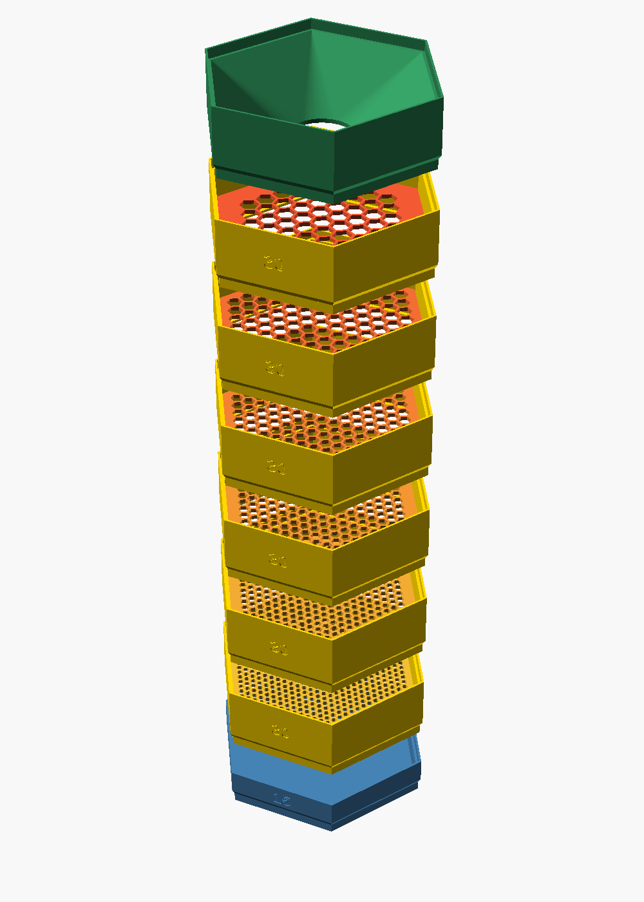
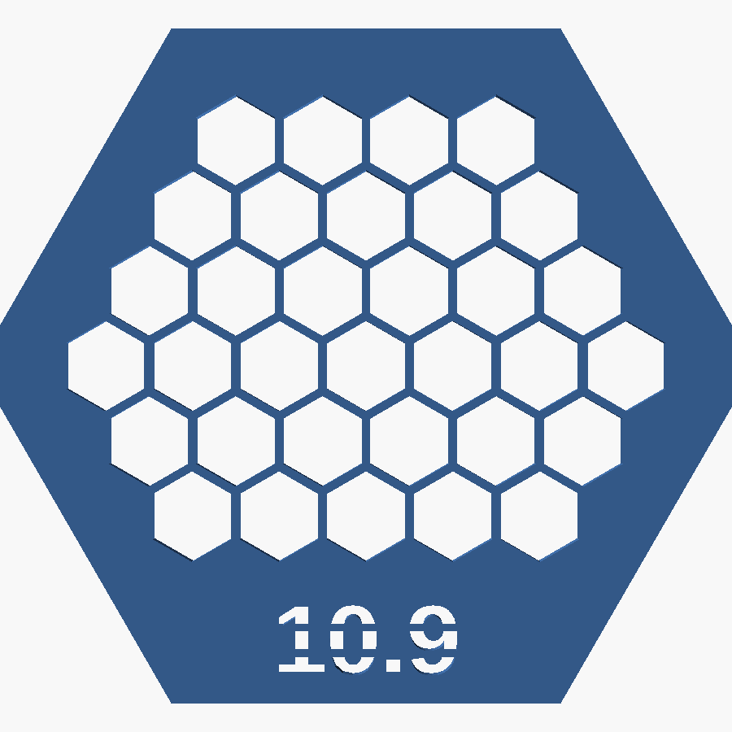
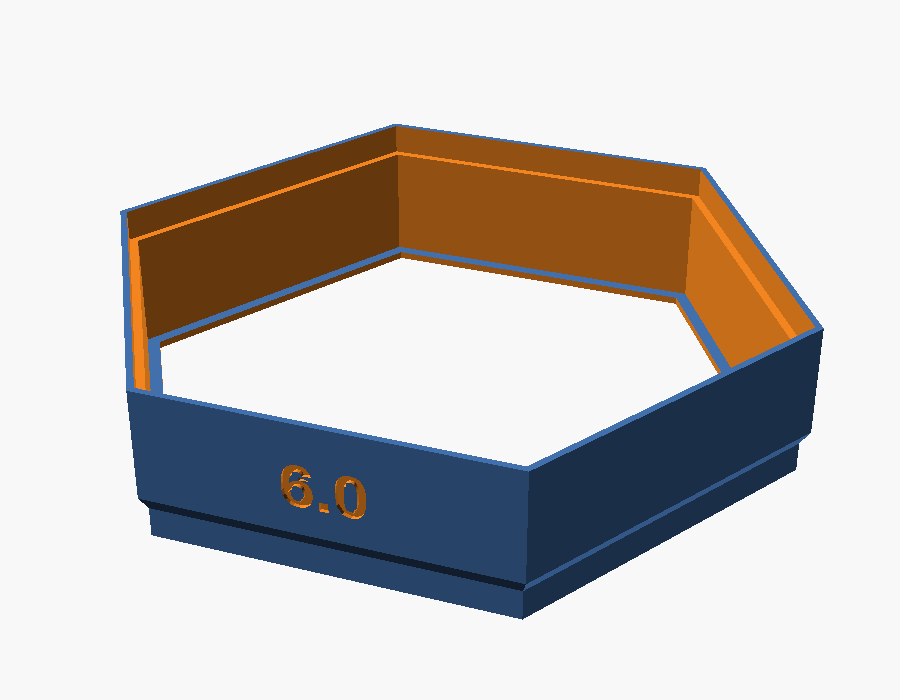

# Hex screw sorter

A parametric, stackable sorter for small screws, nuts and washers, written in OpenSCAD.
Pour a handful of mixed hardware into the funnel, shake, and every ring catches the parts
that are too big for its sieve plate. Everything prints without supports.



## Parts

| Part | What it is |
|---|---|
| **Sieve plate** | Flat 2 mm plate with a honeycomb of hex holes and the hole size cut through as a stencil number. Prints flat in minutes. |
| **Ring** | Open hex ring with a small lip at the bottom. The sieve plate drops in and rests on the lip, so ring and plate lift off together. Front: sieve size, back: height in mm. |
| **Cup** | Closed hex cup with a floor, optional 2, 3 or 6 compartments. Catches whatever passes the finest sieve. |
| **Lid** | Closes the top of a stack. |
| **Funnel** | Hex-to-round funnel that sits on top of the stack. |

<p>


</p>

All modules are 100 mm across flats and stack on each other in any order.

## Stacking joint

The wall (2.4 mm) is split into an outer and an inner half:

- **Top:** the outer half rises as a socket with a square edge; the inner half ends lower as a ledge.
- **Bottom:** the inner half extends down as a spigot that rests on the ledge of the module below.
  The outer face runs into the spigot through a 60° chamfer, so nothing prints in mid-air.
- 0.3 mm radial clearance between socket and spigot, a 0.3 mm air gap at the outer seam.
- The stack pitch is exactly the module height, so a 20 mm ring adds 20 mm to the stack.

## Ready-made STL files

All files stand on z = 0 and are manifold. Rings and cups are 20 mm tall (25 mm including the spigot).

### `set_M3/` – M3 screws and nuts

| File | Sieve (across flats) | Keeps |
|---|---|---|
| `sieve_3.3.stl` + `ring_20mm_3.3.stl` | 3.3 mm | M3 screws, passes washers/small parts |
| `sieve_6.0.stl` + `ring_20mm_6.0.stl` | 6.0 mm | M3 nuts (5.5 mm) |
| `cup_20mm.stl` | – | bottom cup |
| `lid.stl` | – | lid |

### `set_M4/` – M4 screws and nuts

| File | Sieve | Keeps |
|---|---|---|
| `sieve_4.3.stl` + `ring_20mm_4.3.stl` | 4.3 mm | M4 screws |
| `sieve_7.6.stl` + `ring_20mm_7.6.stl` | 7.6 mm | M4 nuts (7 mm) |

### `set_nuts/` – larger nuts

The sieve is about 9 % larger than the nut across flats, but still smaller than the nut across
corners, so a nut lying flat cannot fall through.

| File | Sieve | Keeps nuts across flats |
|---|---|---|
| `sieve_8.7.stl` + `ring_20mm_8.7.stl` | 8.7 mm | 8 mm (M5) |
| `sieve_10.9.stl` + `ring_20mm_10.9.stl` | 10.9 mm | 10 mm (M6) |
| `sieve_12.0.stl` + `ring_20mm_12.0.stl` | 12.0 mm | 11 mm (M7) |
| `sieve_13.1.stl` + `ring_20mm_13.1.stl` | 13.1 mm | 12 mm |

Cup and lid are the same for every set – use the ones in `set_M3/`.

## Make your own

Open `hex_sorter.scad` in OpenSCAD and use the Customizer, or export from the command line:

```bash
# sieve plate with 5.3 mm holes
openscad -o sieve_5.3.stl -D 'part="sieve"' -D sieve_d=5.3 hex_sorter.scad

# 20 mm ring labelled with its sieve size
openscad -o ring_5.3.stl -D 'part="ring"' -D height_mm=20 -D 'ring_label="5.3"' hex_sorter.scad

# 30 mm cup with 3 compartments
openscad -o cup.stl -D 'part="cup"' -D height_mm=30 -D dividers=3 hex_sorter.scad
```

`part` can be `stack`, `lineup`, `section` (views) or `sieve`, `cup`, `ring`, `lid`, `funnel` (single parts).

Useful parameters:

| Parameter | Default | Meaning |
|---|---|---|
| `hex_af` | 100 | Footprint across flats [mm] |
| `height_u` / `height_mm` | 2 / 0 | Height in units of 15 mm, or in mm when > 0 |
| `sieve_d` | 4.3 | Hole size across flats [mm] |
| `hole_comp` | 0.1 | Added to every hole to compensate for printing shrinkage |
| `chamfer_angle` | 60 | Bottom chamfer angle from horizontal [°] |
| `clearance` | 0.3 | Radial clearance in the stacking joint [mm] |
| `ring_label` | "" | Text on the ring front (empty = height in mm) |

Sieve plates are built purely in 2D and export in seconds, even with hundreds of holes.

## Printing tips

- PLA or PETG, 0.2 mm layers, no supports.
- Cups and rings print standing on the spigot; the bed contact is narrow, so a brim helps on large parts.
- Sieve plates print flat. Measure one hole after printing: if it comes out smaller than the
  nominal size, increase `hole_comp` and export again.

## License

[CC BY 4.0](LICENSE) – free to use, remix and share, including commercially, with attribution.
